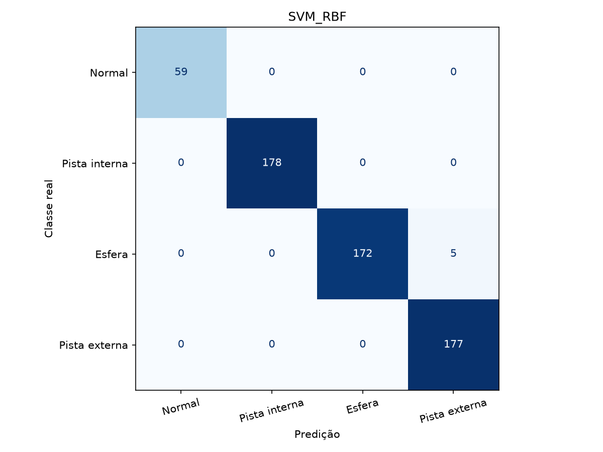
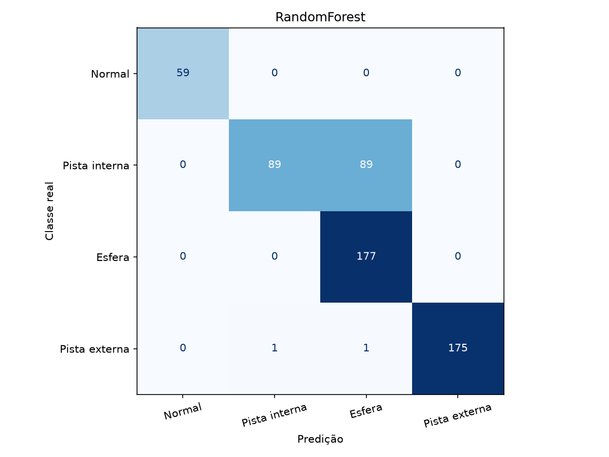

# Detecção e diagnóstico de falhas de rolamentos com o CWRU

ECM514 — Ciência de Dados — Projeto Desafio do 2º Semestre de 2026

**Integrantes:** preencher com os nomes e RAs do grupo (máximo de seis). **Dataset escolhido:** CWRU. **Data da execução:** 06/11/2026.

## Resumo

Este trabalho compara detecção de anomalias e diagnóstico de falhas em vibração real do CWRU. São utilizadas 40 gravações, quatro classes e 17 atributos temporais e espectrais. A divisão por carga utiliza 0 e 1 HP para treino, 2 HP para validação e 3 HP para teste. A SVM RBF, escolhida por macro-F1 na validação, alcançou 99,15% de acurácia e macro-F1 de 0,9929 no teste. A Random Forest alcançou 84,60% e apresentou confusão entre pista interna e esfera. Os detectores treinados somente com dados normais detectaram todas as falhas, mas seus falsos positivos cresceram na carga de teste: 23,73% no Isolation Forest e 100% no One-Class SVM. O contraste mostra que distinguir normalidade de falha e identificar o defeito são problemas diferentes. A avaliação vale para o recorte e a carga estudados, sem comprovar desempenho em campo.

## 1. Problema e objetivos

O objetivo é detectar alterações em sinais de vibração e diagnosticar sua origem entre pista interna, esfera e pista externa. Há dois regimes: detecção sem exemplos de falha no ajuste do detector e classificação supervisionada com rótulos das quatro classes. Comparam-se alternativas e um baseline que sempre prediz a classe majoritária. Os rótulos de referência vêm da condição experimental publicada pelo CWRU, não de uma rotulagem criada pelo grupo.

## 2. Dataset, bancada e recorte

A fonte é o Bearing Data Center da Case Western Reserve University [1–4]. A bancada contém motor Reliance Electric de 2 HP, transdutor de torque/encoder e dinamômetro. Acelerômetros foram fixados por bases magnéticas na carcaça, próximos aos rolamentos. Neste estudo é utilizado exclusivamente o canal drive end, identificado por `*_DE_time`; canais fan end e base não são atributos de entrada.

Os defeitos físicos foram produzidos por eletroerosão (EDM). São medições reais de vibração de uma bancada com defeitos induzidos, e não sinais sintetizados por software. O próprio enunciado sugere CWRU. Essa característica limita a extrapolação para degradação natural e deve ser reconhecida na apresentação.

O recorte inclui normalidade e defeitos de pista interna, esfera e pista externa, com diâmetros de 0,007, 0,014 e 0,021 polegada (0,1778; 0,3556; 0,5334 mm). Para pista externa utiliza-se apenas a posição de 6 horas conforme a tabela de arquivos da fonte. Cada combinação de tipo e diâmetro possui quatro cargas: 0, 1, 2 e 3 HP, com velocidades nominais próximas de 1797, 1772, 1750 e 1730 rpm. Os valores reais disponíveis no MAT estão no manifesto; nem todos os arquivos contêm RPM. Carga, RPM, diâmetro, número do arquivo e nome do canal são metadados e não entram no treinamento.

**Taxas de aquisição:** os defeitos selecionados pertencem à coleção DE de 12 kHz. Para os arquivos normais 97–100 adota-se a convenção de aquisição a 48 kHz, reduzida a 12 kHz por `resample_poly` com filtro anti-aliasing. Os MAT não codificam explicitamente a taxa e a página do baseline não a informa por arquivo; logo, esta é uma premissa de processamento a conferir com a documentação original antes da entrega. A página da bancada documenta aquisições a 12 e 48 kHz. O estudo de benchmark [5] deve orientar essa conferência. Incluímos uma análise de sensibilidade à interpretação alternativa de 12 kHz na seção 7. Não se deve inferir a taxa apenas pelo tamanho do vetor ou esconder essa ambiguidade.

### 2.1 Quantidades e rastreabilidade

| classe        |   gravacoes |   pontos_originais |
|:--------------|------------:|-------------------:|
| Normal        |           4 |            1698547 |
| Pista interna |          12 |            1463077 |
| Esfera        |          12 |            1463166 |
| Pista externa |          12 |            1464906 |

“Pontos originais” conta amostras escalares do canal DE antes da reamostragem. Cada janela é uma observação para o modelo; não é uma repetição independente do experimento. Os 134 MiB aproximados de MAT incluem canais adicionais que não são usados.

| classe        |   teste |   treino |   validacao |   total |
|:--------------|--------:|---------:|------------:|--------:|
| Normal        |      59 |       88 |          59 |     206 |
| Pista interna |     178 |      354 |         177 |     709 |
| Esfera        |     177 |      354 |         177 |     708 |
| Pista externa |     177 |      354 |         177 |     708 |

Totais calculados: treino = 1150, validação = 590, teste = 591, total = 2331. Estes valores calculados são os adotados no trabalho.

O arquivo `dados/manifesto.csv` identifica todos os MAT, URL oficial, SHA-256, canal, classe, carga, diâmetro, partição e contagem de pontos. O código fixa os 40 hashes verificados e interrompe se um arquivo divergir. O arquivo 99 contém `X098_DE_time` e `X099_DE_time`; seleciona-se `X099_DE_time` explicitamente. Isso evita usar acidentalmente uma gravação de outra carga.

## 3. Fundamentação e escolha dos métodos

### 3.1 Atributos temporais e espectrais

Impactos de defeitos alteram amplitude, impulsividade e distribuição espectral. Os 17 atributos são RMS, pico a pico, pico absoluto, assimetria, curtose de Pearson, fator de crista, fator de forma, fator de impulso, centroide espectral, dispersão espectral, entropia espectral e seis energias relativas nas bandas 0–1, 1–2, 2–3, 3–4, 4–5 e 5–6 kHz. A média de cada janela é removida, mas a amplitude não é normalizada por janela, preservando informação energética.

O PSD é estimado por Welch com segmentos de 512 pontos, janela Hann e sobreposição padrão de 50% dentro da estimação espectral. Essa sobreposição interna não mistura conjuntos nem altera o fato de as janelas de exemplos terem sobreposição zero. Se p é a potência normalizada em cada bin, o centroide é soma(f·p), a dispersão é a raiz de soma((f−centroide)²·p) e a entropia é −soma(p·ln p)/ln K. Os fatores temporais usam o pico, o RMS e a média absoluta. Randall e Antoni [6] fundamentam os sinais de impacto; Welch [7] fundamenta a estimação espectral. São atributos genéricos: não foi implementada análise de envelope nem identificação explícita de frequências cinemáticas de defeito.

### 3.2 Isolation Forest — detecção

Partições aleatórias tendem a isolar observações raras com caminhos mais curtos. É uma alternativa de baixo custo para um vetor de atributos e não exige distribuição gaussiana. O ajuste utiliza somente normalidade de treino; escores maiores, após inversão de `score_samples`, indicam maior anomalia. Há 300 árvores e semente 42. Duas referências específicas: Liu, Ting e Zhou [8,9].

### 3.3 One-Class SVM — detecção

A One-Class SVM estima o suporte da distribuição normal por uma fronteira no espaço de atributos. O kernel RBF permite formas não lineares, mas depende da escala e pode reagir à mudança de carga. Utilizam-se `nu=0,05` e `gamma=scale`. O parâmetro nu não representa uma taxa garantida de falsos positivos em dados futuros. Duas referências específicas: Schölkopf et al. [10,11].

### 3.4 Random Forest — diagnóstico

A floresta combina árvores treinadas com aleatoriedade, representando relações não lineares e interações sem impor uma fronteira simples. É adequada a atributos tabulares e fornece uma análise exploratória de importância por redução de impureza. Essa importância não estabelece causalidade e pode favorecer variáveis correlacionadas. Utilizam-se 300 árvores, pesos de classe balanceados e comparação de folhas mínimas 1, 3 e 5. Duas referências: Breiman [12] e Liaw e Wiener [13].

### 3.5 SVM RBF — diagnóstico

A SVM busca separar classes com margem e regularização; o kernel RBF modela relações não lineares com poucos milhares de exemplos. A padronização usa exclusivamente o treino. Comparam-se C em {0,1; 1; 10}, com `gamma=scale` e pesos balanceados. O SVC utiliza decomposição multiclasse one-versus-one. Duas referências: Cortes e Vapnik [14] e Schölkopf e Smola [15].

O DummyClassifier com estratégia `most_frequent` é uma referência mínima sem aprendizado do sinal. Não é proposto como técnica de diagnóstico útil.

## 4. Metodologia e protocolo de avaliação

1. Baixar e verificar os 40 arquivos oficiais por hash. Não gerar dados sintéticos e não aplicar oversampling sintético.
2. Atribuir treino às cargas 0–1 HP (20 gravações), validação a 2 HP (10 gravações) e teste a 3 HP (10 gravações), antes do janelamento.
3. Usar somente o canal DE correto e uniformizar a taxa conforme a premissa declarada. Dividir cada gravação em janelas contíguas de 2048 pontos (170,67 ms a 12 kHz); descartar o resto incompleto.
4. Extrair os 17 atributos. Asserções verificam ausência de IDs de gravação compartilhados entre partições e ausência de valores não finitos.
5. Para detectores, ajustar o StandardScaler e o modelo somente em janelas normais de treino. Calibrar o limiar no percentil 95 dos escores normais de validação, método `higher`, e predizer anomalia se escore > limiar. Não usar falhas de teste para escolher o limiar. O alvo aproximado de FPR de validação é 5%; a discretização produz 2/59 = 3,39% em ambos os detectores.
6. Para classificadores, ajustar cada candidato somente no treino. Selecionar por macro-F1 na validação, com desempate pelo primeiro candidato da lista predefinida. A SVM escolheu C=0,1 e a Random Forest folha mínima 1. Não há refit em treino+validação, para preservar o protocolo comparável.
7. Avaliar todos os modelos no teste reservado. O teste não foi usado para otimização. A SVM já liderava a validação (macro-F1 1,0000 contra 0,9972 da floresta), sendo a recomendação escolhida por esse critério. Relatar os resultados ruins sem retreinar com base neles.

O split impede vazamento entre janelas de uma mesma gravação, mas não garante separação de rolamentos físicos: o mesmo defeito/rolamento pode ter sido medido em cargas distintas. O protocolo avalia principalmente mudança de carga no mesmo domínio experimental. Não demonstra generalização para um rolamento, máquina ou tipo de defeito nunca vistos.

### 4.1 Métricas

Na detecção, “positivo” significa qualquer falha: TPR = TP/(TP+FN), FPR = FP/(FP+TN). Nos classificadores, qualquer classe diferente de Normal é positiva para calcular essas mesmas métricas. Também se reportam acurácia global, macro-F1, precisão, recall e F1 de cada classe e matrizes de confusão. A coluna solicitada como “acurácia por classe” é operacionalizada como **recall da classe** (acertos daquela classe divididos pelo número real de exemplos dela); o significado é explícito para evitar uma acurácia one-versus-rest inflada por negativos.

Não são estimados intervalos de confiança tratando janelas como independentes. Há somente dez gravações no teste e apenas uma gravação normal nessa carga. As métricas descrevem essas janelas, sem significância estatística para uma população industrial.

## 5. Resultados

### 5.1 Tabela padronizada exigida pelo enunciado

| Dataset           | Técnica         | Tipo de falha identificada           |   Taxa de detecção (TPR) |   Falso positivo (FPR) | Acurácia por classe (recall)                                                 |
|:------------------|:----------------|:-------------------------------------|-------------------------:|-----------------------:|:-----------------------------------------------------------------------------|
| CWRU — recorte DE | IsolationForest | não se aplica                        |                   1.0000 |                 0.2373 | não se aplica                                                                |
| CWRU — recorte DE | OneClassSVM     | não se aplica                        |                   1.0000 |                 1.0000 | não se aplica                                                                |
| CWRU — recorte DE | RandomForest    | Pista interna; Esfera; Pista externa |                   1.0000 |                 0.0000 | Normal: 1.0000; Pista interna: 0.5000; Esfera: 1.0000; Pista externa: 0.9887 |
| CWRU — recorte DE | SVM_RBF         | Pista interna; Esfera; Pista externa |                   1.0000 |                 0.0000 | Normal: 1.0000; Pista interna: 1.0000; Esfera: 0.9718; Pista externa: 1.0000 |
| CWRU — recorte DE | Baseline_dummy  | Pista interna; Esfera; Pista externa |                   1.0000 |                 1.0000 | Normal: 0.0000; Pista interna: 0.0000; Esfera: 1.0000; Pista externa: 0.0000 |

As métricas na tabela estão em proporção, de 0 a 1. As matrizes completas das quatro classes do recorte estão no Anexo A e nos CSV/PNG de `resultados/`. O recorte não inclui todo o acervo CWRU, outras posições, diâmetros maiores nem falhas no fan end.

### 5.2 Diagnóstico

| Modelo | Acurácia global | Macro-F1 | Acurácia balanceada |
|---|---:|---:|---:|
| Random Forest | 0,8460 | 0,8639 | 0,8722 |
| SVM RBF | 0,9915 | 0,9929 | 0,9929 |
| Baseline majoritário | 0,2995 | 0,1152 | 0,2500 |

A SVM acertou 586 das 591 janelas, com cinco erros de esfera classificados como pista externa. Todos esses erros ocorreram no arquivo 188 (esfera, 0,014 polegada, 3 HP). O recall de esfera foi 172/177 = 97,18%. A floresta acertou 500/591: das 178 janelas de pista interna, 89 foram confundidas com esfera. No arquivo 108, acertou apenas 2/60; no 172, 28/59. Houve ainda duas falhas na pista externa: uma classificada como pista interna e uma como esfera.

### 5.3 Detecção

| Detector | TN | FP | FN | TP | ROC-AUC |
|---|---:|---:|---:|---:|---:|
| Isolation Forest | 45 | 14 | 0 | 532 | 0,9924 |
| One-Class SVM | 0 | 59 | 0 | 532 | 1,0000 |

A ROC-AUC perfeita da One-Class SVM não contradiz FPR=100%: ela avalia ordenação dos escores ao variar todos os limiares. O limiar fixado em normalidade de validação deixou todas as janelas de teste acima dele. Ordenar bem não garante que uma calibração transfira entre cargas. O baseline majoritário também atinge TPR=100% e FPR=100%, mostrando por que TPR isolada é insuficiente.

## 6. Discussão crítica

**O que funcionou:** a representação de 17 atributos com SVM separou as quatro famílias de condição na carga reservada. A comparação por macro-F1 e o baseline evitam esconder o desequilíbrio: o normal tem muito menos janelas que as classes com três diâmetros. As matrizes revelam o tipo de erro, e o detalhamento por gravação localiza falhas concentradas.

**O que falhou:** a Random Forest teve macro-F1 quase perfeito na validação e caiu para 0,8639 no teste, principalmente em pista interna. Fronteiras de árvores não extrapolam bem para regiões de atributos fora dos cortes aprendidos; a mudança de carga e diâmetro pode explicar o padrão, mas não foi feito experimento causal que prove essa hipótese. A One-Class SVM e o Isolation Forest foram sensíveis ao deslocamento da distribuição normal. A escolha de limiar em 2 HP não controlou a taxa de falsos alarmes em 3 HP.

**Limitações:** a bancada é controlada, os defeitos são induzidos e conhecidos, não há degradação contínua nem avaliação de antecedência de alerta. As classes usadas são famílias amplas: não se diagnostica o diâmetro. A mesma unidade física pode aparecer em cargas distintas. Há só uma gravação normal de teste; as janelas consecutivas têm dependência temporal. Normalidade e defeitos vêm de aquisições com taxas possivelmente diferentes, gerando uma possível pista de aquisição mesmo após reamostragem. RMS e bandas espectrais podem capturar essa diferença em vez de exclusivamente a condição mecânica. Padronização e divisão por gravação não eliminam esse confundimento. O desempenho alto deve ser confirmado com normal e defeito adquiridos no mesmo protocolo.

**Próximos passos:** confirmar documentalmente a taxa de cada baseline; repetir em novas gravações normais por carga; reservar rolamentos físicos inteiros quando os IDs estiverem disponíveis; avaliar outras cargas reservadas com validação aninhada por grupo; comparar atributos invariantes à amplitude, análise de envelope e frequências características; testar Paderborn ou dados de falha natural. Para operação, calibrar limiares com normalidade representativa das cargas esperadas e medir falsos alertas por hora, sem retocar o limiar com os rótulos do teste atual.

## 7. Sensibilidade à premissa de taxa do baseline

Como verificação adicional, executou-se o mesmo pipeline interpretando os arquivos normais como 12 kHz, sem reamostragem. É um cenário alternativo de sensibilidade, não uma correção comprovada da fonte e não um candidato selecionado pelo teste. Essa mudança altera a duração física atribuída às janelas, o número de exemplos normais e o equilíbrio das classes, além dos atributos espectrais. Portanto, não é uma ablação pura de frequência.

| Cenário | Janelas normais de teste | FPR Isolation Forest | FPR One-Class SVM |
|---|---:|---:|---:|
| Normal a 48 kHz, reduzido a 12 kHz — principal | 59 | 0,2373 | 1,0000 |
| Normal interpretado como 12 kHz — sensibilidade | 237 | 0,0717 | 0,3671 |

A diferença confirma que os números de detecção dependem da premissa de aquisição. Os arquivos de métricas e ambiente do cenário alternativo estão em `resultados/sensibilidade_taxa/`. O experimento principal permanece congelado; não se escolhe a interpretação pela métrica mais favorável. O script `sensibilidade.py` reproduz o cenário em pasta separada.

## 8. Reprodutibilidade, entregas e uso de IA

O notebook `CWRU_Projeto.ipynb` contém o código integral, instrução de instalação, execução e este relatório. Foi executado integralmente em ambiente Python da sessão; não foi executado no serviço Google Colab. Ele usa bibliotecas instaláveis por pip e download HTTP sem credenciais para permitir execução no Colab. `requirements.txt` fixa as versões da execução principal e `resultados/ambiente.json` registra o ambiente. `analise.py` é uma alternativa executável local. Dados reais e hashes acompanham o pacote completo; o notebook também pode baixá-los independentemente.

**Uso de IA:** foi utilizado ChatGPT/Codex para interpretar o enunciado, planejar o protocolo, gerar e executar código, calcular métricas e preparar rascunhos de relatório e slides. As métricas deste documento resultam da execução em arquivos reais do CWRU, não de valores inventados. O grupo deve revisar os conceitos, conferir as referências e a taxa de aquisição, validar o notebook no Colab e assumir responsabilidade pela versão entregue. Não atribuir ao grupo verificações ou decisões que ainda não realizou.

O repositório do projeto é https://github.com/rodrigo-faltz/CD2026-S2. O cadastro do grupo, a inserção dos nomes/RAs e a gravação/publicação do vídeo no YouTube ainda dependem do grupo. Não existe link de vídeo publicado neste pacote. Os slides e o roteiro proposto duram 4min40s, deixando margem para o limite de cinco minutos. O README aponta para todos os arquivos e assinala as pendências sem inventar URLs.

## Referências

1. CWRU Bearing Data Center. Welcome/Overview. https://engineering.case.edu/bearingdatacenter/welcome. Acesso em 06/11/2026.
2. CWRU Bearing Data Center. Apparatus and Procedures. https://engineering.case.edu/bearingdatacenter/apparatus-and-procedures. Acesso em 06/11/2026.
3. CWRU Bearing Data Center. 12k Drive End Bearing Fault Data. https://engineering.case.edu/bearingdatacenter/12k-drive-end-bearing-fault-data. Acesso em 06/11/2026.
4. CWRU Bearing Data Center. Normal Baseline Data. https://engineering.case.edu/bearingdatacenter/normal-baseline-data. Acesso em 06/11/2026.
5. SMITH, W. A.; RANDALL, R. B. Rolling element bearing diagnostics using the Case Western Reserve University data: A benchmark study. Mechanical Systems and Signal Processing, 64–65, 100–131, 2015. https://doi.org/10.1016/j.ymssp.2015.04.021.
6. RANDALL, R. B.; ANTONI, J. Rolling element bearing diagnostics—A tutorial. Mechanical Systems and Signal Processing, 25(2), 485–520, 2011. https://doi.org/10.1016/j.ymssp.2010.07.017.
7. WELCH, P. D. The use of fast Fourier transform for the estimation of power spectra: A method based on time averaging over short, modified periodograms. IEEE Transactions on Audio and Electroacoustics, 15(2), 70–73, 1967. https://doi.org/10.1109/TAU.1967.1161901.
8. LIU, F. T.; TING, K. M.; ZHOU, Z.-H. Isolation Forest. IEEE ICDM, 413–422, 2008. https://doi.org/10.1109/ICDM.2008.17.
9. LIU, F. T.; TING, K. M.; ZHOU, Z.-H. Isolation-Based Anomaly Detection. ACM Transactions on Knowledge Discovery from Data, 6(1), artigo 3, 2012. https://doi.org/10.1145/2133360.2133363.
10. SCHÖLKOPF, B. et al. Support Vector Method for Novelty Detection. Advances in Neural Information Processing Systems 12, 582–588, 2000 (conferência de 1999). https://proceedings.neurips.cc/paper/1999/hash/8725fb777f25776ffa9076e44fcfd776-Abstract.html.
11. SCHÖLKOPF, B. et al. Estimating the Support of a High-Dimensional Distribution. Neural Computation, 13(7), 1443–1471, 2001. https://doi.org/10.1162/089976601750264965.
12. BREIMAN, L. Random Forests. Machine Learning, 45, 5–32, 2001. https://doi.org/10.1023/A:1010933404324.
13. LIAW, A.; WIENER, M. Classification and Regression by randomForest. R News, 2(3), 18–22, 2002. https://CRAN.R-project.org/doc/Rnews/Rnews_2002-3.pdf.
14. CORTES, C.; VAPNIK, V. Support-vector networks. Machine Learning, 20, 273–297, 1995. https://doi.org/10.1007/BF00994018.
15. SCHÖLKOPF, B.; SMOLA, A. J. Learning with Kernels: Support Vector Machines, Regularization, Optimization, and Beyond. MIT Press, 2002. https://mitpress.mit.edu/9780262194754/learning-with-kernels/.

## Anexo A — Matrizes de confusão completas

Linhas: classe real. Colunas: classe predita. Ordem: Normal, Pista interna, Esfera, Pista externa.

### SVM RBF

|               |   Normal |   Pista interna |   Esfera |   Pista externa |
|:--------------|---------:|----------------:|---------:|----------------:|
| Normal        |       59 |               0 |        0 |               0 |
| Pista interna |        0 |             178 |        0 |               0 |
| Esfera        |        0 |               0 |      172 |               5 |
| Pista externa |        0 |               0 |        0 |             177 |

### Random Forest

|               |   Normal |   Pista interna |   Esfera |   Pista externa |
|:--------------|---------:|----------------:|---------:|----------------:|
| Normal        |       59 |               0 |        0 |               0 |
| Pista interna |        0 |              89 |       89 |               0 |
| Esfera        |        0 |               0 |      177 |               0 |
| Pista externa |        0 |               1 |        1 |             175 |

### Baseline majoritário

|               |   Normal |   Pista interna |   Esfera |   Pista externa |
|:--------------|---------:|----------------:|---------:|----------------:|
| Normal        |        0 |               0 |       59 |               0 |
| Pista interna |        0 |               0 |      178 |               0 |
| Esfera        |        0 |               0 |      177 |               0 |
| Pista externa |        0 |               0 |      177 |               0 |

### Exemplos de sinal e espectro

