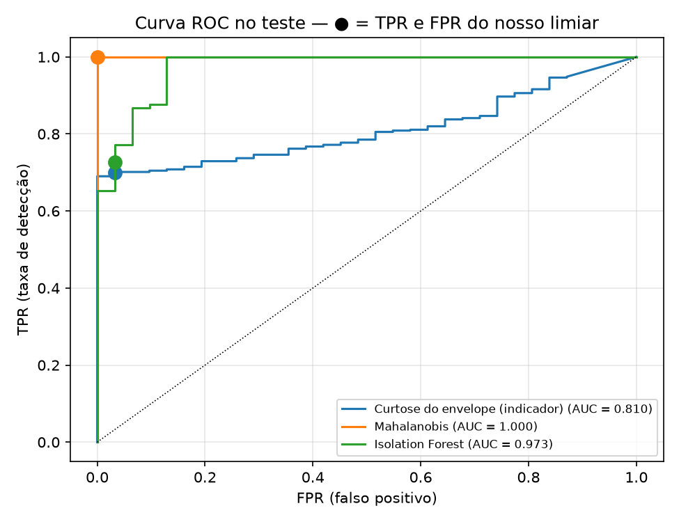
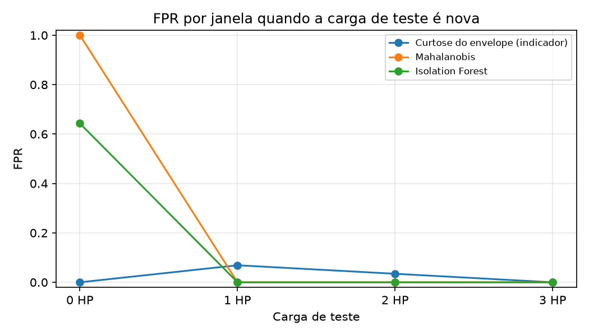
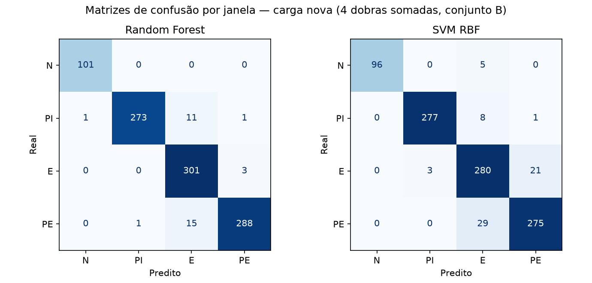
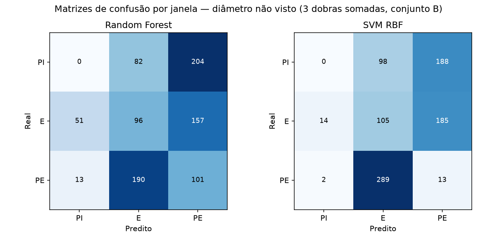
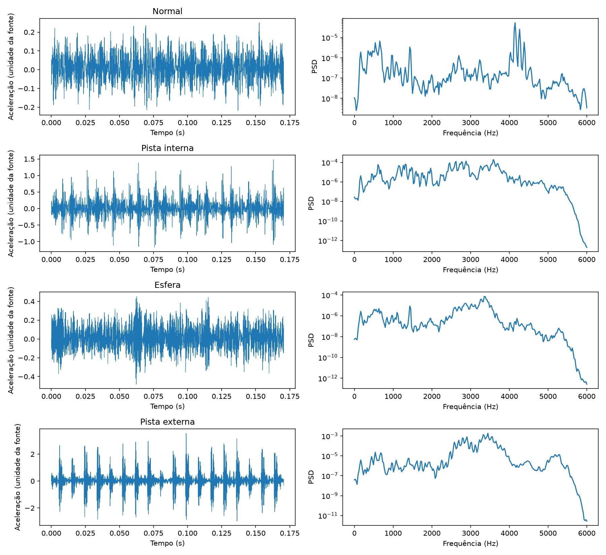
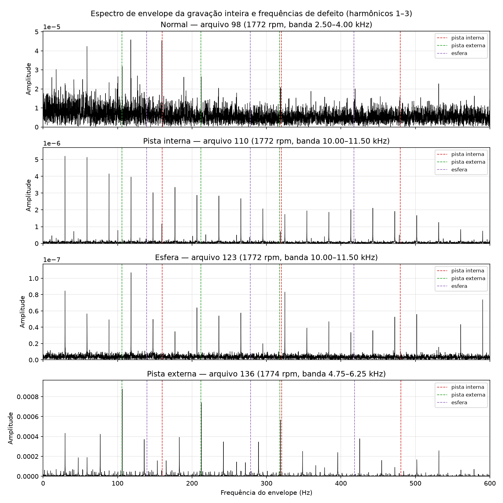
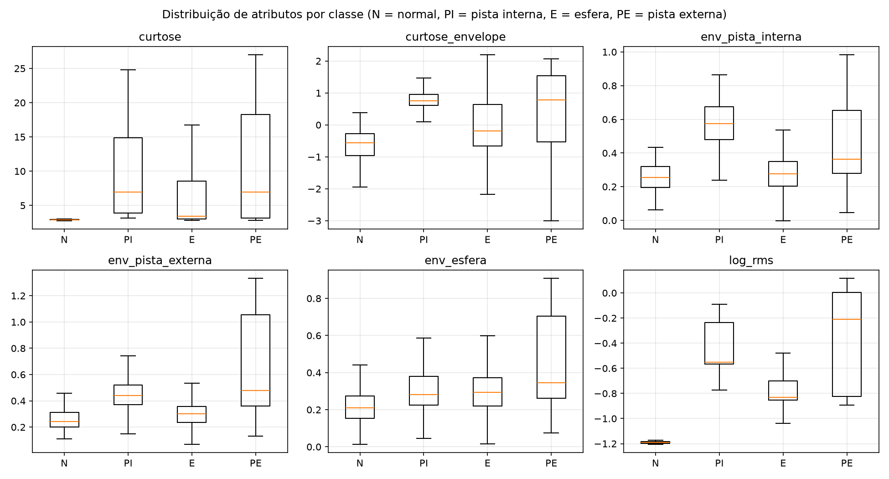
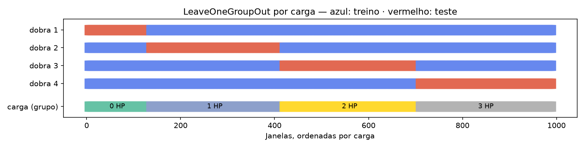

# Detecção e diagnóstico de falhas em rolamentos com o CWRU a 48 kHz

**ECM514 — Ciência de Dados · Projeto Desafio do 2º semestre de 2026**

**Integrantes:** Amanda Carolina Ambrizzi Ramin (22.00721-0) · André Felipe Silva Xavier (22.01339-3) · Otto Camargo Kuchkarian (22.00571-4) · Rafael Assanti (22.01464-0) · Rodrigo Fernandes Faltz (21.01660-7)

**Repositório:** https://github.com/rodrigo-faltz/CD2026-S2 · **Notebook:** [`CWRU_Projeto.ipynb`](CWRU_Projeto.ipynb)

## Resumo

Este trabalho estuda dois problemas sobre sinais reais de vibração do *Bearing Data Center* da Case Western Reserve
University (CWRU): **detectar** que um rolamento deixou de estar normal e **diagnosticar** onde está o defeito (pista
interna, esfera ou pista externa). Usamos 40 gravações do acelerômetro do lado do acionamento, todas da coleção de
48 kHz — inclusive as normais —, o que elimina a necessidade de reamostrar sinais de taxas diferentes. Combinamos
atributos estatísticos com **análise de envelope**, a técnica clássica de diagnóstico de rolamentos, e avaliamos tudo
com validação cruzada **por carga** e **por diâmetro de defeito**, separando gravações inteiras (a única exceção, um
cenário otimista de detecção, está descrita na seção 4.3).

Três resultados resumem o trabalho:

1. **Detecção:** os detectores treinados só com dados normais ordenam as janelas quase perfeitamente (ROC-AUC de 0,975 a
   1,000), mas o limiar não se transfere entre cargas: com carga não vista, o melhor compromisso foi o do Isolation
   Forest (TPR 80,8%, FPR 8,9%). Com uma referência normal em cada carga, a distância de Mahalanobis detecta 100% das
   falhas sem falsos alarmes.
2. **Diagnóstico com carga não vista:** Random Forest acerta 96,8% das janelas (macro-F1 médio de 0,95) e 92,5% das
   gravações. O pior caso é a carga de 0 HP (macro-F1 de 0,83).
3. **Diagnóstico com diâmetro não visto:** os mesmos modelos caem **abaixo do acaso** (macro-F1 de 0,07 a 0,12). Só os atributos
   de envelope generalizam em parte, e a regra física baseada no envelope acerta 69% das gravações. A alta acurácia
   comum no CWRU mede, em grande parte, o reconhecimento de gravações conhecidas — e não do tipo de defeito.

## 1. Problema e objetivos

Rolamentos com defeito localizado produzem impactos periódicos a cada passagem de um elemento rolante pelo defeito.
Esses impactos excitam ressonâncias da estrutura e modulam o sinal de vibração numa frequência que depende da geometria
do rolamento, da rotação e da posição do defeito [7, 8]. O enunciado pede pelo menos uma solução de detecção de anomalias
e de diagnóstico do tipo de falha, comparando alternativas. Formulamos três perguntas:

- **Detecção (não supervisionada):** com acesso só à vibração normal, é possível alarmar quando surge um defeito sem
  gerar alarmes falsos?
- **Diagnóstico (supervisionado):** com exemplos rotulados, é possível identificar o tipo de defeito?
- **Generalização:** os modelos funcionam numa **carga** que não viram? E num **diâmetro de defeito** que não viram?

A terceira pergunta foi motivada pela literatura: Smith & Randall [6] mostram que vários registros do CWRU não exibem
sintomas claros de falha, e Hendriks et al. [23] mostram que a forma de dividir os dados do CWRU infla a acurácia
reportada em muitos trabalhos — um caso de vazamento de informação [24].

## 2. Dataset

### 2.1 Origem e bancada

Os dados são públicos e documentados pelo CWRU [1–5]. A bancada tem um motor Reliance Electric de 2 HP, um transdutor de
torque/encoder e um dinamômetro. Defeitos pontuais foram usinados por eletroerosão (EDM) em rolamentos SKF 6205-2RS JEM
do lado do acionamento (*drive end*, DE). A vibração foi medida por acelerômetros com base magnética na carcaça do motor,
na posição de 12 horas, e registrada a 12 ou 48 mil amostras por segundo [2]. São medições reais de bancada: os defeitos
são induzidos artificialmente, mas nenhum sinal foi gerado por software.

Geometria do rolamento e frequências de defeito em múltiplos da rotação do eixo [5]:

| Diâmetro interno | Diâmetro externo | Diâmetro da esfera | Diâmetro primitivo | BPFI | BPFO | 2×BSF | FTF |
|---|---|---|---|---|---|---|---|
| 0,9843" | 2,0472" | 0,3126" | 1,537" | 5,4152 | 3,5848 | 4,7135 | 0,39828 |

### 2.2 Recorte e justificativa

| Item | Escolha | Justificativa |
|---|---|---|
| Taxa | Coleção de **48 kHz** do drive end [3] | É a taxa das gravações normais [4]. A duração confirma: os normais 98–100 têm ≈ 485 mil amostras (10 s a 48 kHz), como as falhas de 48 kHz. Com a coleção de 12 kHz, seria preciso reamostrar o normal, e os modelos poderiam aprender a diferença de aquisição no lugar da falha. |
| Classes | Normal, pista interna, esfera, pista externa | Os três tipos de defeito do dataset mais a condição sem defeito. |
| Diâmetros | 0,007", 0,014" e 0,021" | Todos os disponíveis a 48 kHz. O diâmetro de 0,028" só existe a 12 kHz, sem pista externa. |
| Pista externa | Somente posição 6h | As posições 3h e 12h não existem para 0,014" [3]. Incluí-las desequilibraria a classe e misturaria posição com severidade. |
| Cargas | 0, 1, 2 e 3 HP (≈ 1797 a 1720 rpm) | Todas, usadas como grupos de validação. |
| Canal | Somente `*_DE_time` | O sensor junto do rolamento defeituoso. |

### 2.3 Quantidades por classe

| Classe | Gravações | Amostras | Duração | Janelas (0 / 1 / 2 / 3 HP) | Total de janelas |
|---|---:|---:|---:|---|---:|
| Normal | 4 | 1.698.547 | 35,4 s | 14 / 29 / 29 / 29 | 101 |
| Pista interna | 12 | 4.830.126 | 100,7 s | 31 / 81 / 87 / 87 | 286 |
| Esfera | 12 | 5.121.960 | 106,7 s | 43 / 87 / 87 / 87 | 304 |
| Pista externa | 12 | 5.122.638 | 106,7 s | 43 / 87 / 87 / 87 | 304 |
| **Total** | **40** | **16.773.271** | **349,5 s** | | **995** |

Cada janela tem 16.384 amostras (0,34 s). O normal tem uma gravação por carga, contra três por carga em cada classe de
falha. As gravações de 0 HP têm cerca de 5 s, metade das demais.

### 2.4 Integridade e peculiaridades da fonte

O arquivo [`dados/manifesto.csv`](dados/manifesto.csv) registra, para cada gravação, URL oficial, SHA-256, canal usado,
número de amostras, rotação e se ela foi medida. O notebook confere todos os hashes e interrompe a execução se algum
divergir. Peculiaridades tratadas explicitamente:

- `174.mat` (pista interna 0,014", 0 HP) contém a variável `X173_DE_time`, com só 63.788 amostras (1,3 s, 3 janelas).
- `99.mat` contém também as variáveis do arquivo 98; `175.mat` e `217.mat` contêm variáveis de outras gravações. Em
  todos os casos usa-se apenas a variável do próprio arquivo.
- Os normais 98 e 99 não registram a rotação; usa-se o valor nominal da carga (1772 e 1750 rpm).

## 3. Fundamentação das técnicas

### 3.1 Análise de envelope

Os impactos de um defeito localizado são curtos e excitam ressonâncias de alta frequência. A frequência de repetição dos
impactos não aparece diretamente no espectro, mas aparece no **espectro do envelope** do sinal filtrado na banda de
ressonância — a técnica de ressonância de alta frequência, ou *demodulação* [7, 8]. O passo crítico é escolher a banda.
A **curtose espectral** mede em que frequências o sinal é mais impulsivo, e o **kurtograma** a usa para escolher a banda de
demodulação sem conhecer o defeito [9–11]. Smith & Randall [6] usaram a análise de envelope com banda escolhida pelo
kurtograma entre os métodos de referência do benchmark do CWRU. A técnica faz sentido aqui porque transforma o problema num teste físico: há picos na frequência de pista interna,
de pista externa ou de esfera?

### 3.2 Atributos estatísticos e espectrais

RMS, curtose, fatores de crista e impulso medem amplitude e impulsividade, que crescem com defeitos [7]. A densidade
espectral estimada pelo método de Welch [12] resume como a energia se distribui em frequência. São os atributos mais usados
em diagnóstico por aprendizado de máquina [21, 22], mas não carregam conhecimento sobre a geometria do rolamento.

### 3.3 Detectores de anomalia

| Técnica | Por que faz sentido para o problema | Referências |
|---|---|---|
| **Curtose do envelope** | Indicador de saúde clássico: defeitos tornam o sinal impulsivo. Não aprende nada além do limiar. | [9, 10] |
| **Distância de Mahalanobis** | Mede o afastamento da nuvem normal considerando as correlações entre atributos. A covariância de Ledoit-Wolf estabiliza a estimativa com poucas amostras normais (35 a 87 janelas por dobra). | [16, 17] |
| **Isolation Forest** | Isola pontos raros com poucos cortes aleatórios. Não supõe forma de distribuição e já foi aplicado à detecção de anomalias em sinais de rolamentos. | [13, 14, 15] |

### 3.4 Classificadores de diagnóstico

| Técnica | Por que faz sentido para o problema | Referências |
|---|---|---|
| **Random Forest** | Combina árvores com aleatoriedade, captura interações não lineares entre atributos heterogêneos e é robusta a atributos irrelevantes. Foi proposta e avaliada especificamente para diagnóstico de falhas em máquinas. | [18, 19] |
| **SVM com kernel RBF** | Separa classes por margem máxima e funciona bem com poucos milhares de exemplos. É uma das técnicas mais estudadas em diagnóstico de falhas de máquinas. | [20, 21] |
| **Regra de envelope** | Diagnóstico físico sem aprendizado de fronteiras: vence o defeito cujo indicador é maior. É a referência do benchmark do CWRU. | [6, 7] |

## 4. Metodologia

### 4.1 Pré-processamento e janelas

O sinal DE de cada gravação é dividido em janelas contíguas de 16.384 amostras (0,34 s ≈ 10 rotações), sem sobreposição;
o resto incompleto é descartado. A janela foi escolhida para que o espectro de envelope tenha resolução de 2,9 Hz,
suficiente para separar as frequências de defeito (106, 139 e 160 Hz a 1772 rpm). Cada janela herda rótulo, carga e
diâmetro da gravação. **As divisões de dados não separam janelas de uma mesma gravação**, exceto no cenário 6.1 do
notebook (referência normal em cada carga), em que cada gravação normal é dividida em terços no tempo — por isso ele é
otimista quanto ao FPR.

### 4.2 Atributos

São 23 atributos por janela, em quatro grupos:

- **Amplitude (2):** log₁₀ do RMS e do pico.
- **Forma de onda (6):** curtose, assimetria e fatores de crista, forma, impulso e folga.
- **Espectro (11):** centroide, dispersão e entropia do espectro de Welch normalizado (segmentos de 1024 pontos) e energia
  relativa em oito bandas de 3 kHz entre 0 e 24 kHz.
- **Envelope (4):** curtose do envelope e três indicadores de defeito (BPFI, BPFO e 2×BSF).

Para o envelope, a banda é escolhida **uma vez por gravação**, sobre o próprio sinal e sem rótulos: entre bandas de 1,5,
3 e 6 kHz de largura entre 1 e 12 kHz, vence a de maior curtose espectral (kurtograma simplificado [11]). O sinal é
filtrado (Butterworth de 4ª ordem, fase zero), demodulado pela transformada de Hilbert e elevado ao quadrado [7]. Cada
indicador é o log₁₀ da razão entre a média dos picos nos três primeiros harmônicos da frequência de defeito (tolerância de
±2% para o escorregamento) e a mediana do espectro do envelope entre 10 e 600 Hz. A rotação é usada só para localizar as
frequências, não como atributo.

A faixa de busca foi limitada a 12 kHz depois de observar que, sem esse limite, a banda escolhida ficava quase sempre
entre 21,5 e 23 kHz — perto da metade da taxa de amostragem —, inclusive nos sinais normais. É um efeito do sistema de
aquisição, e não do defeito. A observação não usou rótulos.

Dois conjuntos de atributos foram definidos antes de qualquer avaliação:

- **B — adimensionais + envelope** (21 atributos, **conjunto principal**): forma de onda, espectro e envelope. A amplitude
  fica de fora porque varia com a carga e com o ganho do sensor; ela é calculada só para a figura exploratória.
- **C — somente envelope** (4 atributos): usado no protocolo de diâmetro não visto, para testar se a física do rolamento,
  sozinha, generaliza para um defeito de tamanho novo.

### 4.3 Protocolos de avaliação

**Por que não usar um sorteio de janelas.** A divisão usual das aulas, `train_test_split` com sorteio de linhas, coloca
janelas da mesma gravação no treino e no teste. O notebook (seção 5) compara três divisões com a mesma Random Forest:

| Divisão | Acurácia no teste |
|---|---|
| (a) sorteio de janelas (as 40 gravações ficam dos dois lados) | 99,3% |
| (b) carga nova — teste em 0 / 1 / 2 / 3 HP | 85,5% / 100% / 99,7% / 99,3% |
| (c) diâmetro novo, só falhas — teste em 0,007" / 0,014" / 0,021" | 33,7% / 32,8% / 5,3% |

Separar por carga quase não muda a nota, porque no CWRU o mesmo rolamento é gravado nas quatro cargas e o modelo
continua a reconhecê-lo; só a carga atípica de 0 HP cai. Com diâmetro novo, o rolamento do teste é realmente
desconhecido, e a nota fica no nível do chute (33%) ou abaixo. O vazamento, portanto, não é só de janelas: é do
rolamento. Por isso toda divisão é feita por gravação, com o `LeaveOneGroupOut` do scikit-learn (cada grupo vira teste
uma vez), exceto no cenário 6.1, em que cada gravação normal é dividida em terços no tempo — por isso ele é otimista
quanto ao FPR. Os dois tipos de grupo respondem perguntas diferentes: carga nova (mesmo rolamento, outra condição) e
diâmetro novo (rolamento novo).

**Protocolo 1 — carga não vista.** Validação cruzada com 4 dobras: treino com três cargas e teste na quarta. Cada
gravação é testada exatamente uma vez.

**Protocolo 2 — diâmetro não visto.** Somente as 36 gravações de falha, com 3 dobras: treino com dois diâmetros (todas as
cargas) e teste no terceiro. Mede se o modelo reconhece o tipo de defeito numa severidade nova.

**Detecção.** No protocolo 1, cada detector é ajustado só com as janelas normais das três cargas de treino. O limiar é o
percentil 99 de escores de normais *fora da amostra*: dentro do treino, cada carga normal é pontuada por um detector
ajustado nas outras duas. Assim o limiar já incorpora uma mudança de carga, sem olhar o teste.

**Detecção com referência por carga (treino, validação e teste).** Para separar o problema da detecção do problema da
calibração, cada gravação normal é dividida em três trechos contíguos no tempo, como na divisão treino/validação/teste das
aulas: o primeiro ajusta o detector (35 janelas no total), o segundo escolhe o limiar (35) e o terceiro é usado como teste
(31), junto com todas as janelas de falha. Esse cenário é otimista quanto ao FPR, porque o normal de teste vem da mesma
gravação do treino.

**Seleção de hiperparâmetros.** Em cada dobra externa, Random Forest (folha mínima ∈ {1, 5, 10}, 300 árvores, pesos
balanceados) e SVM (C ∈ {0,1; 1; 10; 100}, `gamma='scale'`, padronização ajustada no treino, pesos balanceados) são
escolhidos com `GridSearchCV(cv=LeaveOneGroupOut(), scoring='f1_macro')`, no mesmo formato do laço de seleção de
modelos das aulas (`base_estimators`, `param_grids`). A validação cruzada **interna** usa os mesmos grupos (cargas ou
diâmetros do treino), e o teste da dobra externa é usado uma única vez. No conjunto B e carga não vista, a Random Forest escolheu folha 1 nas quatro
dobras, e a SVM escolheu C = 10 em uma e C = 100 em três.

**Regra de envelope.** Calculada sobre o envelope da gravação inteira. No protocolo 1, uma gravação é Normal se seu maior
indicador não ultrapassar o maior valor visto nas gravações normais de treino; senão, vence o maior indicador. No
protocolo 2, sem normais, vence sempre o maior indicador.

### 4.4 Métricas

- **Detecção:** TPR = TP/(TP+FN) e FPR = FP/(FP+TN), com qualquer falha como positivo; ROC-AUC calculada em cada dobra
  e promediada. A curva ROC do cenário com referência por carga marca o ponto (FPR, TPR) do limiar escolhido.
- **Diagnóstico:** acurácia, macro-F1 (média do F1 das classes, que não é dominada pelas classes maiores), recall por
  classe e matriz de confusão. Para preencher a tabela do enunciado, TPR e FPR dos classificadores tratam como alarme
  qualquer predição diferente de Normal, e a "acurácia por classe" é o recall da classe.
- Métricas por janela somam as dobras; também se reportam média, desvio e pior dobra, além da decisão por gravação (voto
  majoritário das janelas).

Não se calculam intervalos de confiança tratando janelas como independentes: janelas da mesma gravação são
correlacionadas, e há apenas quatro gravações normais.

## 5. Resultados

### 5.1 Tabela resumo (formato do enunciado)

Protocolo 1 (carga não vista), conjunto B, 4 dobras somadas. Métricas por janela, exceto a regra de envelope (por
gravação). N = normal, PI = pista interna, E = esfera, PE = pista externa. "Tipo de falha identificada" lista as classes
com recall ≥ 0,5; "acurácia por classe" é o recall. A tabela é copiada de `resultados/tabela_resumo.md`, gerada pelo
notebook.

| Dataset        | Técnica                                                | Tipo de falha identificada           |   Taxa de detecção (TPR) |   Falso positivo (FPR) | Acurácia por classe (se houver diagnóstico)   |
|:---------------|:-------------------------------------------------------|:-------------------------------------|-------------------------:|-----------------------:|:----------------------------------------------|
| CWRU 48 kHz DE | Curtose do envelope (indicador) — detecção, por janela | não se aplica                        |                   0.6790 |                 0.0297 | não se aplica                                 |
| CWRU 48 kHz DE | Mahalanobis — detecção, por janela                     | não se aplica                        |                   0.7282 |                 0.1386 | não se aplica                                 |
| CWRU 48 kHz DE | Isolation Forest — detecção, por janela                | não se aplica                        |                   0.8076 |                 0.0891 | não se aplica                                 |
| CWRU 48 kHz DE | Random Forest — diagnóstico, por janela                | Pista interna; Esfera; Pista externa |                   0.9989 |                 0.0000 | N: 1.00; PI: 0.95; E: 0.99; PE: 0.95          |
| CWRU 48 kHz DE | SVM RBF — diagnóstico, por janela                      | Pista interna; Esfera; Pista externa |                   1.0000 |                 0.0495 | N: 0.95; PI: 0.97; E: 0.92; PE: 0.90          |
| CWRU 48 kHz DE | Regra de envelope — diagnóstico, por gravação          | Pista interna; Pista externa         |                   0.5833 |                 0.2500 | N: 0.75; PI: 0.83; E: 0.00; PE: 0.75          |

As matrizes de confusão completas estão no Anexo A.

### 5.2 Detecção

**Referência normal em cada carga (treino, validação e teste).**

| Detector | TPR | FPR | ROC-AUC |
|---|---:|---:|---:|
| Curtose do envelope | 0,700 | 0,032 | 0,810 |
| Mahalanobis | **1,000** | **0,000** | 1,000 |
| Isolation Forest | 0,726 | 0,032 | 0,973 |

FPR de 0,032 corresponde a 1 das 31 janelas normais de teste. Na curva ROC, o ponto de cada detector mostra o TPR e o FPR
do limiar escolhido na validação (percentil 99).

**Carga não vista (protocolo 1).**

| Detector | TPR | FPR | ROC-AUC (média das dobras) | FPR em 0 HP | FPR em 1–3 HP |
|---|---:|---:|---:|---:|---:|
| Curtose do envelope | 0,679 | 0,030 | 0,829 | 0,000 | 0,000–0,069 |
| Mahalanobis | 0,728 | 0,139 | 1,000 | 1,000 | 0,000 |
| Isolation Forest | 0,808 | 0,089 | 0,975 | 0,643 | 0,000 |

### 5.3 Diagnóstico — carga não vista

| Conjunto | Modelo | Acurácia | Macro-F1 (média ± desvio) | Pior dobra | Acurácia por gravação |
|---|---|---:|---:|---:|---:|
| **B — adimensionais + envelope** | **Random Forest** | **0,968** | **0,952 ± 0,073** | 0,827 | 0,925 |
| B — adimensionais + envelope | SVM RBF | 0,933 | 0,930 ± 0,042 | 0,873 | 0,900 |
| — | Regra de envelope (por gravação) | — | — | — | 0,550 |

Macro-F1 em cada carga de teste:

| Modelo | 0 HP | 1 HP | 2 HP | 3 HP |
|---|---:|---:|---:|---:|
| Random Forest | **0,827** | 0,997 | 0,991 | 0,994 |
| SVM RBF | **0,873** | 0,933 | 0,923 | 0,991 |

A pior dobra é sempre a de 0 HP. Testar só numa carga, como 3 HP, mostraria 0,99 e esconderia esse pior caso.

### 5.4 Diagnóstico — diâmetro não visto

| Conjunto | Modelo | Macro-F1 0,007" | Macro-F1 0,014" | Macro-F1 0,021" | Acurácia por gravação |
|---|---|---:|---:|---:|---:|
| B | Random Forest | 0,167 | 0,155 | 0,033 | 0,222 |
| B | SVM RBF | 0,029 | 0,171 | 0,019 | 0,111 |
| C | Random Forest | 0,332 | 0,437 | 0,466 | 0,556 |
| C | SVM RBF | 0,729 | 0,481 | 0,465 | 0,639 |
| — | **Regra de envelope** (por gravação) | — | — | — | **0,694** |

Com três classes, um classificador aleatório teria macro-F1 ≈ 0,33.

### 5.5 Onde os erros acontecem

- **Carga não vista:** os erros da Random Forest se concentram em 0 HP (27 das 32 janelas erradas; arquivos 201, 213 e
  174) e no diâmetro de 0,014" (23 das 32), quase sempre confundidos com esfera. A SVM erra de forma mais espalhada,
  principalmente em 1 e 2 HP (49 das 67 janelas erradas), sobretudo nos arquivos 202 (pista externa, 0,014") e 124
  (esfera, 0,007"); ela também classifica 5 janelas do normal de 0 HP (arquivo 97) como esfera. O arquivo 174 tem só 3
  janelas.
- **Regra de envelope:** não reconhece **nenhuma** das 12 gravações de esfera. As esferas de 0,007" a 0 e 1 HP aparecem
  como pista interna (o indicador de BPFI é o maior); as demais ficam abaixo do limiar de normalidade. Cinco gravações
  de 0,014" (pista interna 174 e 177; pista externa 202, 203 e 204) também ficam abaixo do limiar. O normal de 0 HP
  (97) tem indicador de pista interna alto (log₁₀ = 0,97): quando está no teste, é classificado como pista interna;
  quando está no treino, eleva o limiar de normalidade.
- **Diâmetro não visto:** Random Forest e SVM com o conjunto B atribuem praticamente todas as gravações do diâmetro
  novo a uma única classe (por exemplo, todas as de 0,014" viram "Esfera").

## 6. Discussão crítica

### 6.1 O que funcionou

- **Análise de envelope nas pistas.** A regra física identifica corretamente todas as gravações de pista interna e de
  pista externa de 0,007" e 0,021" mesmo sem treino de fronteiras, e é o método que melhor generaliza para um diâmetro
  não visto (69% das gravações).
- **Detectores bem calibrados.** Com uma referência normal na mesma carga, Mahalanobis detecta todas as falhas sem falsos
  alarmes. Um método simples basta quando a referência é adequada — o Isolation Forest, mais sofisticado, foi
  pior nesse cenário (TPR de 72,6%).
- **Diagnóstico com carga nova.** Random Forest e SVM generalizam bem para uma carga não vista (macro-F1 médio ≥ 0,93).
  O desempenho, porém, não é igual em todas as cargas: com 0 HP no teste, a macro-F1 cai para 0,83 (RF) e 0,87 (SVM).
  Por isso o protocolo testa as quatro cargas, e não só uma.

### 6.2 O que não funcionou e por quê

- **Transferência do limiar entre cargas.** Os escores separam normal e falha (ROC-AUC ≈ 1), mas o limiar não. O normal
  de 0 HP difere dos demais, e com uma única gravação normal por carga é impossível saber se essa diferença vem da carga
  ou da sessão de gravação. Quando 0 HP está no teste, os detectores disparam em 64% a 100% das janelas normais; quando está no treino,
  o limiar sobe e parte das falhas passa despercebida.
- **Generalização para diâmetros novos.** É o resultado mais importante do trabalho. Os modelos estatísticos atingem
  ≈ 95% com carga nova e caem abaixo do acaso com diâmetro novo. A explicação mais provável é que cada combinação de tipo
  e diâmetro corresponde a um rolamento físico, montado e gravado numa sessão, e as gravações de cargas diferentes desse
  mesmo rolamento são muito parecidas. No protocolo de carga, o modelo reconhece *o rolamento* e acerta; no protocolo de
  diâmetro, o rolamento é novo e o modelo não sabe o que distingue os tipos de defeito. Isso é coerente com a discussão
  de Hendriks et al. [23] sobre como a divisão dos dados do CWRU afeta a acurácia reportada, e com a definição de
  vazamento de Kapoor & Narayanan [24]. Os atributos de envelope, ligados à cinemática do defeito, são os únicos que
  carregam essa informação para um rolamento novo.
- **Esfera.** O defeito de esfera gira com a esfera e entra e sai da zona de carga, então os impactos são irregulares e
  o pico em 2×BSF é fraco. No benchmark de Smith & Randall [6], os defeitos de esfera também foram os de diagnóstico
  menos bem-sucedido. Os classificadores acertam esfera com carga
  nova provavelmente pelo mesmo reconhecimento de rolamento descrito acima, e não por um sintoma físico.
- **Diâmetro de 0,014".** É o pior diâmetro para a regra de envelope e concentra os erros dos classificadores com carga
  nova. Os indicadores de envelope dessas gravações são, em geral, mais baixos que os de 0,007" e 0,021" (ver
  `resultados/envelope_por_gravacao.csv`), e o arquivo 174 tem só 1,3 s de sinal. Smith & Randall [6] relatam que vários
  registros do CWRU não exibem os sintomas esperados do defeito; não investigamos a causa física neste grupo.

### 6.3 Mudança em relação às versões anteriores

Uma versão anterior deste trabalho usava as falhas da coleção de 12 kHz com os normais reamostrados de 48 para 12 kHz,
uma única divisão (treino 0–1 HP, validação 2 HP, teste 3 HP) e só atributos estatísticos. Ela chegava a 99% de acurácia
com a SVM. Abandonamos esse protocolo por dois motivos: a diferença de taxa de aquisição entre normal e falha podia ser
aprendida no lugar do defeito, e uma única divisão com uma só gravação normal no teste não permitia avaliar a
variabilidade. O protocolo atual responde perguntas mais difíceis e mostra que a acurácia alta não equivale a um
diagnóstico físico.

A versão seguinte comparava também One-Class SVM, autoencoder, um baseline majoritário e um terceiro conjunto de
atributos (estatísticos + espectro, com amplitude). Na versão final, esses itens foram retirados porque não mudavam
nenhuma conclusão: One-Class SVM e autoencoder tinham a mesma ROC-AUC e o mesmo padrão de falso alarme por carga que
Mahalanobis e não o superaram em nenhum cenário (taxa de detecção igual ou menor, falso alarme igual ou maior), e o
conjunto com amplitude ficava empatado com o conjunto B. O conjunto C (só envelope) passou a ser avaliado apenas no
protocolo de diâmetro, onde ele faz diferença. A seleção de hiperparâmetros passou a usar o `GridSearchCV` no formato
visto em aula. As predições dos modelos mantidos são idênticas às da versão anterior.

### 6.4 Limitações

- **Poucos dados normais:** quatro gravações, uma por carga, somando 35 s. O FPR de cada dobra se apoia em uma gravação.
- **Defeitos induzidos:** cortes por EDM, não desgaste natural; não há degradação ao longo do tempo nem avaliação de
  antecedência de alerta.
- **Uma bancada, um modelo de rolamento:** não há validação em outra máquina.
- **Janelas correlacionadas:** janelas da mesma gravação não são observações independentes; por isso também se reporta a
  decisão por gravação.
- **Rotação nominal:** dois normais não registram a rotação.
- **Busca de hiperparâmetros pequena** e kurtograma simplificado (bandas fixas, não o algoritmo rápido completo [11]).

### 6.5 O que mudaria com mais tempo ou dados

- Gravar **mais referências normais por carga**, em sessões diferentes, para calibrar limiares que transfiram entre
  condições — ou usar limiares condicionados à carga medida.
- Validar **deixando o rolamento inteiro de fora** e em outros datasets com degradação natural (Paderborn, IMS),
  conforme recomendam Hendriks et al. [23].
- Implementar o kurtograma rápido completo [11] e a análise cicloestacionária, mais adequada a defeitos de esfera [7].
- Testar redes convolucionais sobre o sinal bruto ou o espectro de envelope [25], sempre com os protocolos de carga e
  diâmetro não vistos.

## 7. Conclusões

A detecção de falhas no CWRU é fácil quando existe uma referência normal da mesma condição de operação, e difícil quando
o limiar precisa ser transferido entre cargas com pouca normalidade. O diagnóstico com aprendizado de máquina chega a 95%
quando o rolamento já foi visto em outra carga, mas falha quando o defeito tem um tamanho novo. Nesse caso, o
conhecimento físico (frequências de defeito no espectro de envelope) é o que mais generaliza. Para uso em campo,
recomendamos combinar um detector simples calibrado com referência local e um diagnóstico apoiado em envelope, deixando o
aprendizado de máquina para refinar a decisão.

## 8. Reprodutibilidade

- O notebook [`CWRU_Projeto.ipynb`](CWRU_Projeto.ipynb) é a única fonte de código e roda no Google Colab sem
  configuração. As instruções estão no [README](README.md).
- Os 40 arquivos originais estão em [`dados/raw/`](dados/raw/), e o notebook também sabe baixá-los da fonte oficial,
  sempre conferindo o SHA-256.
- Versões dos pacotes e parâmetros ficam em [`resultados/ambiente.json`](resultados/ambiente.json); todas as métricas,
  predições e matrizes ficam em [`resultados/`](resultados/).
- A versão final foi executada do zero sem erros, e os números mantidos foram conferidos automaticamente contra a versão
  anterior; ver [`VALIDACAO.md`](VALIDACAO.md).

## 9. Declaração de uso de inteligência artificial

Ferramentas de IA generativa foram usadas como apoio neste trabalho:

- **ChatGPT/Codex (OpenAI):** primeira versão do código, do relatório e dos slides.
- **Claude (Anthropic):** revisão da primeira versão contra o enunciado, nova versão do código (coleção de 48 kHz,
  análise de envelope, novos detectores e protocolos de validação), verificação das referências bibliográficas no
  Crossref e redação desta versão do relatório e dos slides. Na versão final, simplificação do notebook para o formato das
  aulas (laço com `GridSearchCV`, seção sobre separação de treino e teste, remoção de técnicas que não mudavam as
  conclusões), com conferência automática de que os números mantidos não mudaram.

Todas as métricas resultam da execução do notebook sobre os dados reais do CWRU. As decisões metodológicas, a
interpretação dos resultados e o conteúdo entregue são de responsabilidade do grupo.

## Referências

1. CWRU BEARING DATA CENTER. *Welcome*. Disponível em: https://engineering.case.edu/bearingdatacenter/welcome. Acesso em: 6 nov. 2026.
2. CWRU BEARING DATA CENTER. *Apparatus & Procedures*. Disponível em: https://engineering.case.edu/bearingdatacenter/apparatus-and-procedures. Acesso em: 6 nov. 2026.
3. CWRU BEARING DATA CENTER. *48k Drive End Bearing Fault Data*. Disponível em: https://engineering.case.edu/bearingdatacenter/48k-drive-end-bearing-fault-data. Acesso em: 6 nov. 2026.
4. CWRU BEARING DATA CENTER. *Normal Baseline Data*. Disponível em: https://engineering.case.edu/bearingdatacenter/normal-baseline-data. Acesso em: 6 nov. 2026.
5. CWRU BEARING DATA CENTER. *Bearing Information*. Disponível em: https://engineering.case.edu/bearingdatacenter/bearing-information. Acesso em: 6 nov. 2026.
6. SMITH, W. A.; RANDALL, R. B. Rolling element bearing diagnostics using the Case Western Reserve University data: a benchmark study. *Mechanical Systems and Signal Processing*, v. 64–65, p. 100–131, 2015. https://doi.org/10.1016/j.ymssp.2015.04.021
7. RANDALL, R. B.; ANTONI, J. Rolling element bearing diagnostics — a tutorial. *Mechanical Systems and Signal Processing*, v. 25, n. 2, p. 485–520, 2011. https://doi.org/10.1016/j.ymssp.2010.07.017
8. McFADDEN, P. D.; SMITH, J. D. Vibration monitoring of rolling element bearings by the high-frequency resonance technique — a review. *Tribology International*, v. 17, n. 1, p. 3–10, 1984. https://doi.org/10.1016/0301-679X(84)90076-8
9. ANTONI, J. The spectral kurtosis: a useful tool for characterising non-stationary signals. *Mechanical Systems and Signal Processing*, v. 20, n. 2, p. 282–307, 2006. https://doi.org/10.1016/j.ymssp.2004.09.001
10. ANTONI, J.; RANDALL, R. B. The spectral kurtosis: application to the vibratory surveillance and diagnostics of rotating machines. *Mechanical Systems and Signal Processing*, v. 20, n. 2, p. 308–331, 2006. https://doi.org/10.1016/j.ymssp.2004.09.002
11. ANTONI, J. Fast computation of the kurtogram for the detection of transient faults. *Mechanical Systems and Signal Processing*, v. 21, n. 1, p. 108–124, 2007. https://doi.org/10.1016/j.ymssp.2005.12.002
12. WELCH, P. D. The use of fast Fourier transform for the estimation of power spectra: a method based on time averaging over short, modified periodograms. *IEEE Transactions on Audio and Electroacoustics*, v. 15, n. 2, p. 70–73, 1967. https://doi.org/10.1109/TAU.1967.1161901
13. LIU, F. T.; TING, K. M.; ZHOU, Z.-H. Isolation Forest. In: *IEEE International Conference on Data Mining (ICDM)*, 8., 2008. p. 413–422. https://doi.org/10.1109/ICDM.2008.17
14. LIU, F. T.; TING, K. M.; ZHOU, Z.-H. Isolation-based anomaly detection. *ACM Transactions on Knowledge Discovery from Data*, v. 6, n. 1, art. 3, 2012. https://doi.org/10.1145/2133360.2133363
15. WANG, H.; LI, Q.; LIU, Y.; YANG, S. Anomaly data detection of rolling element bearings vibration signal based on parameter optimization Isolation Forest. *Machines*, v. 10, n. 6, art. 459, 2022. https://doi.org/10.3390/machines10060459
16. DE MAESSCHALCK, R.; JOUAN-RIMBAUD, D.; MASSART, D. L. The Mahalanobis distance. *Chemometrics and Intelligent Laboratory Systems*, v. 50, n. 1, p. 1–18, 2000. https://doi.org/10.1016/S0169-7439(99)00047-7
17. LEDOIT, O.; WOLF, M. A well-conditioned estimator for large-dimensional covariance matrices. *Journal of Multivariate Analysis*, v. 88, n. 2, p. 365–411, 2004. https://doi.org/10.1016/S0047-259X(03)00096-4
18. BREIMAN, L. Random forests. *Machine Learning*, v. 45, p. 5–32, 2001. https://doi.org/10.1023/A:1010933404324
19. YANG, B.-S.; DI, X.; HAN, T. Random forests classifier for machine fault diagnosis. *Journal of Mechanical Science and Technology*, v. 22, n. 9, p. 1716–1725, 2008. https://doi.org/10.1007/s12206-008-0603-6
20. CORTES, C.; VAPNIK, V. Support-vector networks. *Machine Learning*, v. 20, p. 273–297, 1995. https://doi.org/10.1007/BF00994018
21. WIDODO, A.; YANG, B.-S. Support vector machine in machine condition monitoring and fault diagnosis. *Mechanical Systems and Signal Processing*, v. 21, n. 6, p. 2560–2574, 2007. https://doi.org/10.1016/j.ymssp.2006.12.007
22. LEI, Y. et al. Applications of machine learning to machine fault diagnosis: a review and roadmap. *Mechanical Systems and Signal Processing*, v. 138, art. 106587, 2020. https://doi.org/10.1016/j.ymssp.2019.106587
23. HENDRIKS, J.; DUMOND, P.; KNOX, D. A. Towards better benchmarking using the CWRU bearing fault dataset. *Mechanical Systems and Signal Processing*, v. 169, art. 108732, 2022. https://doi.org/10.1016/j.ymssp.2021.108732
24. KAPOOR, S.; NARAYANAN, A. Leakage and the reproducibility crisis in machine-learning-based science. *Patterns*, v. 4, n. 9, art. 100804, 2023. https://doi.org/10.1016/j.patter.2023.100804
25. JIA, F.; LEI, Y.; LIN, J.; ZHOU, X.; LU, N. Deep neural networks: a promising tool for fault characteristic mining and intelligent diagnosis of rotating machinery with massive data. *Mechanical Systems and Signal Processing*, v. 72–73, p. 303–315, 2016. https://doi.org/10.1016/j.ymssp.2015.10.025

## Anexo A — Matrizes de confusão completas

Linhas: classe real. Colunas: classe predita. Dobras somadas; cada janela ou gravação aparece uma única vez.

### A.1 Carga não vista, por janela (conjunto B)

**Random Forest**

| | Normal | Pista interna | Esfera | Pista externa |
|---|---:|---:|---:|---:|
| Normal | 101 | 0 | 0 | 0 |
| Pista interna | 1 | 273 | 11 | 1 |
| Esfera | 0 | 0 | 301 | 3 |
| Pista externa | 0 | 1 | 15 | 288 |

**SVM RBF**

| | Normal | Pista interna | Esfera | Pista externa |
|---|---:|---:|---:|---:|
| Normal | 96 | 0 | 5 | 0 |
| Pista interna | 0 | 277 | 8 | 1 |
| Esfera | 0 | 3 | 280 | 21 |
| Pista externa | 0 | 0 | 29 | 275 |

### A.2 Carga não vista, regra de envelope por gravação

| | Normal | Pista interna | Esfera | Pista externa |
|---|---:|---:|---:|---:|
| Normal | 3 | 1 | 0 | 0 |
| Pista interna | 2 | 10 | 0 | 0 |
| Esfera | 10 | 2 | 0 | 0 |
| Pista externa | 3 | 0 | 0 | 9 |

### A.3 Diâmetro não visto, por janela (conjunto B)

**Random Forest**

| | Pista interna | Esfera | Pista externa |
|---|---:|---:|---:|
| Pista interna | 0 | 82 | 204 |
| Esfera | 51 | 96 | 157 |
| Pista externa | 13 | 190 | 101 |

**SVM RBF**

| | Pista interna | Esfera | Pista externa |
|---|---:|---:|---:|
| Pista interna | 0 | 98 | 188 |
| Esfera | 14 | 105 | 185 |
| Pista externa | 2 | 289 | 13 |

## Anexo B — Figuras exploratórias

